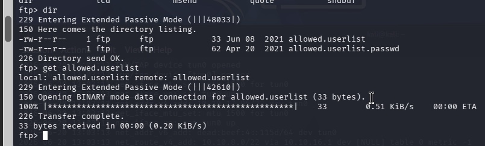
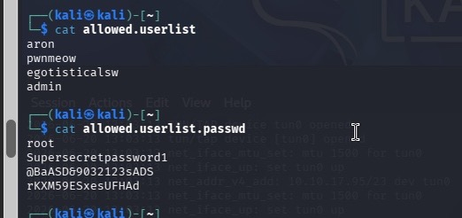
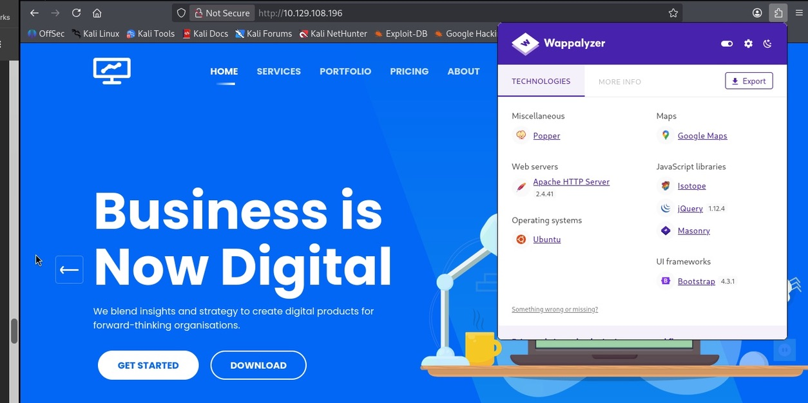
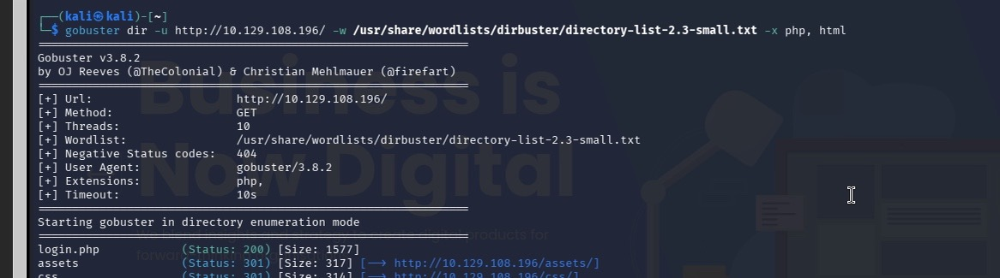
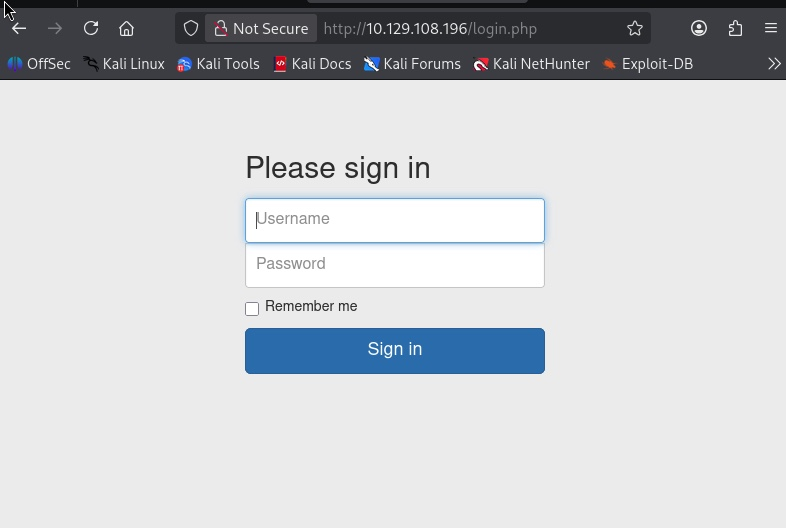
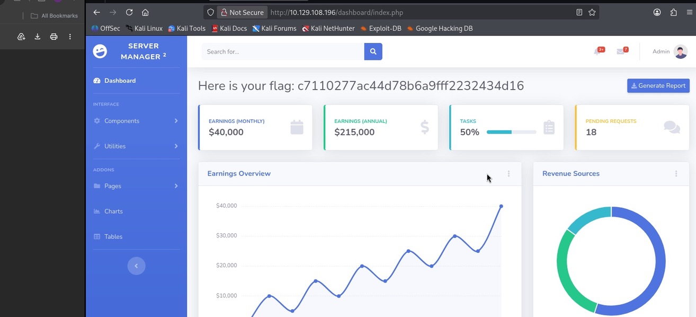

## Target: Crocodile
## Platform: HTB
## Date: 6/24/26
## Difficulty: Easy
## Tools: nmap, Wappalyzer, gobuster


### Recon 

```bash
 nmap -sC -sV 10.129.108.196
```
Scan found two ports
- 21/tcp ftp (vsftpd 3.0.3)
- 80/tcp http (Apache 2.4.41)

Connected to the ftp server 

#### Enumerating FTP

Used Dir in to list the files stored on FTP 



Downloaded both files using `get` 


\

Output the downloaded credentials using `cat`

Attempted to use obtained credentials to gain elevated access, but was denied.

#### Pivot & Website Investigation

After authentication denial I investigated the http server listed on the initial scan.

http://10.129.108.196

Used Wappalyzer to collect the technology stack of the website u


> Notable technologies such as Web Server (Apache 2.4.41), OS (Ubuntu) and JS libraries (jQuery, Isotope)


### Exploitation

Used `Gobuster` to discover hidden and hardly accessible pages and directories. 

```bash
gobuster dir -u 10.129.108.196/ -w /usr/share/wordlists/dirbuster/directory-list-2.3-small.txt -x php, html
```



Gobuster revealed several valuable pages (`login.php`, `assets.php`)
Navigated to the login page at `http://10.129.108.196/login.php`



### Initial Access & Flag Retrieval

Authenticated as admin using prviously obtained credentials and retrieved flag on homepage 




