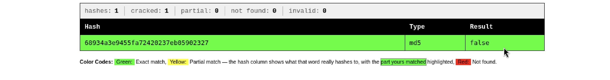
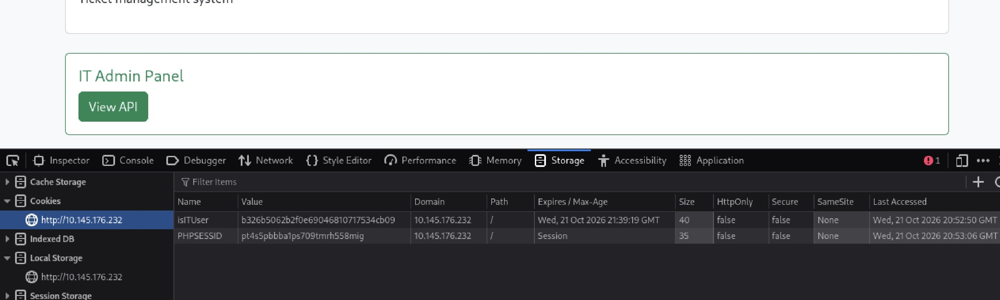
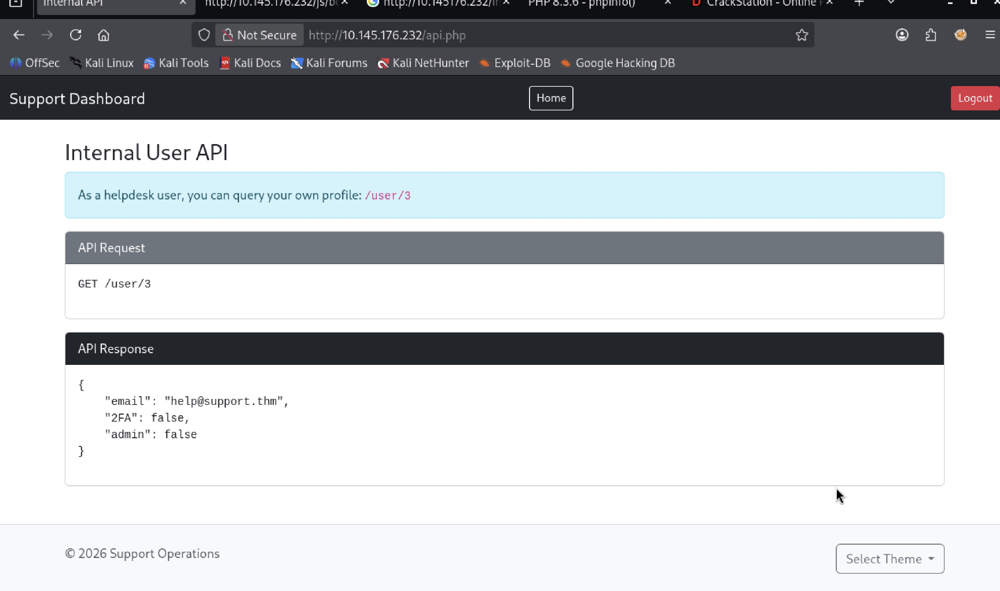
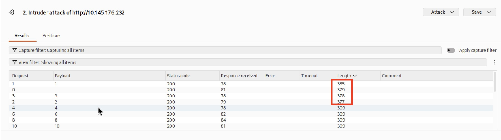
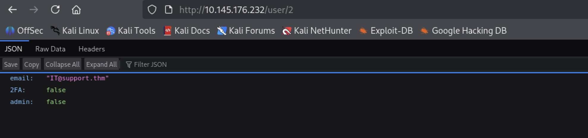
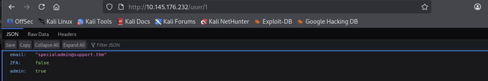
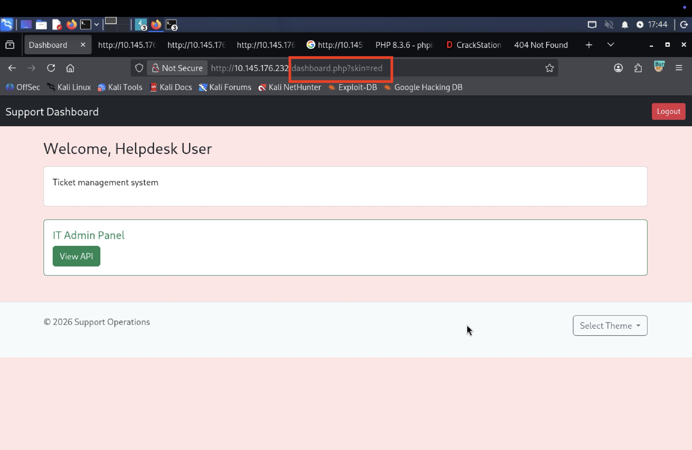

# Recruit — Support Operation Platform

**Platform:** TryHackMe | **Date:** 10/22/26 | **Difficulty:** Medium | **Tools:** Nmap, Gobuster, BurpSuite, ffuf

---

## Recon 

### Network Enumeration

Our network reconnaissance begins with a `nmap` scan to enumerate TCP ports on the targeting machine. We use the `-sV` flag to identify running services and their versions, alongside `-sC` flag which runs default scripts for further service enumeration and information gathering.


> *Initial Nmap scan revealed two open ports: port 22, hosting an SSH service running OpenSSH 9.6p1, and Port 80, hosting a http web server running Apache httpd 2.4.58. Also, NSE scripts found `PHPSESSID`cookie, indicating that Apache HTTP server uses `PHP` as it's server-side scripting language.*

After identifying an HTTP service on port 80, we navigate to the target's IP address in our browser.


> *Visiting the target IP revealed a login page prompting users to enter their credentials*

We see that the email address `help@support.thm` serves as a placeholder for the Corporate Email field and a message under the "Sign In" field reveals that is the email address for IT operations. 

### Web Enumeration

After identifying the login page, we continue our reconnaissance by returning to the terminal and using `Gobuster` to enumerate hidden directories and files on the web server. 


```bash
gobuster dir -u http://10.145.176.232 -w /usr/share/wordlists/dirbuster/directory-list-2.3-small.txt
```


> Directory enumeration finds 4 directories: `/skins`, `/includes`, `/layout`, `/js`


Based on the earlier identification of a `PHPSESSID` cookie, we perform a second scan using `-x php` to enumerate php files.


> Second scan returned several interesting php files: index.php, info.php, footer.php, api.php, logout.php, config.php, dashboard.php 

Most of the identified application endpoints redirected to the login page (`index.php`) when accessed directly, suggesting that authentication may be the prerequisite for accessing their functionality.

---

## Initial Access

### Credential Brute-Forcing 

In order to gain authentication, we need to find a valid set of credentials. Using the previously identified IT operations email, `help@support.thm`, we can attempt to brute-force the web applications login page. We do so by using `ffuf`, a open-source web fuzzing tool 


```bash
ffuf -u http://10.145.176.232/ \
  -X POST \
  -H 'Content-Type: application/x-www-form-urlencoded' \
  -d 'email=help%40support.thm&password=FUZZ' \
  -w /usr/share/wordlists/seclists/Passwords/Common-Credentials/10k-most-common.txt
```

Upon executing the scan, we observed that every authentication returned an `HTTP 200 OK` with an identical response size of 2,768 bytes.


> *Initial ffuf scan made it difficult to distinguish successful authentication attempts from failed ones.*

In order to find an outlier, we add `-fc 200`, which hides HTTP responses that have a status code of 200. 


> *Status code of 302 returned, indicating the login attempt was successful and we were redirected to a page intended for authenticated users.*

We return to the login page and authenticate successfully using the credential pair .


>*We are presented with a dashboard page after successful authentication.*

### Authenticated Enumeration

After successful authentication, we open the browser DevTools to investigate authenticated session information.


> *We see the application issued two cookies: `PHPSESSID`, to maintain the authenticated state, and `isITUser` which appeared to determine whether the user was an IT users or not*

Interestingly `isITUser` is 32 characters long and contains only hexadecimal characters, suggesting that it's value may be hashed. Because of that observation, we head to [CrackStation](https://crackstation.net/) to try to perform a hash lookup.


> *Using CrackStation, we successfully recovered the plaintext value `false` from the MD5 hash*

To test whether `isITUser` could be manipulated to escalate privileges, we generate the MD5 hash of the string `true`.

```bash
echo -n 'true' | md5sum
```

We take the resulting hash and subsitute it for the existing `isITUser` cookie value. 


> *Cookie subsitution successfully worked*

After replacing the original `isITUser` cookie value with the MD5 hash and refreshing the page, a previously hidden IT Admin Panel appeared on the dashboard.

### API Enumeration & IDOR

Navigating to the IT Admin Panel, we are presented with a basic API documentation page, which appears to give users instructions for interacting with the API.


> *API page provides several pieces of API documentation: Endpoint `user/3`, HTTP Method `GET`, example request `GET /user/3`, example JSON response `email`,`2FA`, `admin` fields.*

Visiting the `/user/3` endpoint, we find a JSON response containing account information for `help@support.thm`. The structure of the URL follows common REST API conventions, suggesting that user accounts are identified by numerical ID's. Based on this observation, we intercepted the HTTP request on Burp Suite and sent it to intruder to perform a Sniper attack. By doing so, we hope to enumerate and potentially access additional user resources. 



> *Intruder results showed four outlier response lengths for user ID's: 1, 0, 3, 2*

A longer HTTP response can indicate that the server found a valid resource and returned additional information. To investigate these differences, we navigated to each of the four identified outliers in our browser. Visiting the `/user/2` endpoint returned information about `IT@support.thm`.


> *User 2 objects fields suggested that `IT@support.thm` has the same permissions as `help@support.thm`*

Interestingly, accessing the `/user/1` endpoint returned account information associated with an administrative user.


> *JSON response showed the account had admin privileges (`admin:true`) and had 2FA turned off (`2FA:false`)*

## Local File Inclusion (LFI)

After attempts to exploit mass assignment were unsuccessful, we shifted our attention elsewhere. The `dashboard.php` had a `Select Theme` feature where users were allowed to change the dashboard's background color through a drop-down menu.


> *Selecting Red from the drop down menu updated the URL to include the query parameter `skin` with a value of `red``?skin=red`*

Initial attempts to access common sensitive files such as `/etc/passwd` and `/etc/shadow` through the `skin` query parameter were unsuccessful. This prompted further investigation into the web application's directory structure, particularly the `/skins/` directory, which was found in our initial directory enumeration with `Gobuster`.


toward determining whether the application would accept directory traversal sequences from user-controlled parameters. 


In our initial directory enumeration, `gobuster` identified a `info.php` endpoint. Returning to this finding, we see that the endpoint is dedicated to PHP and server configuration information. 


